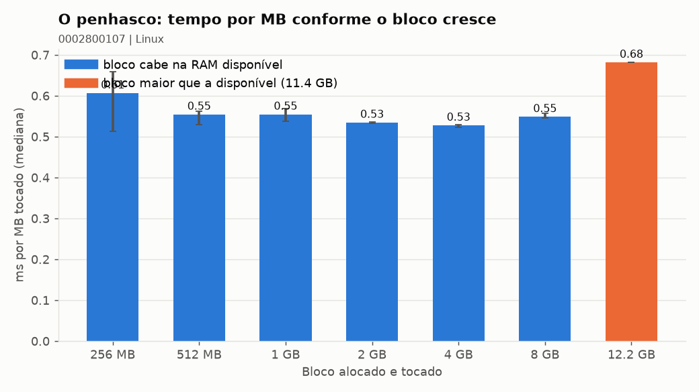
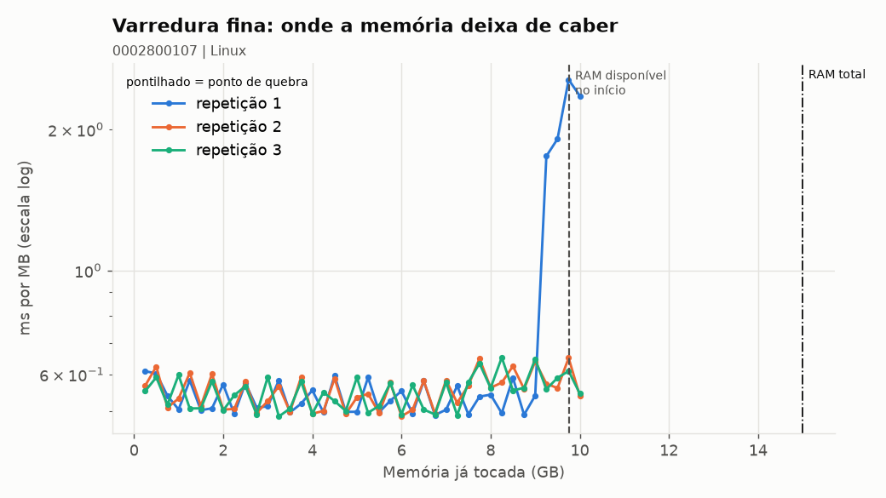
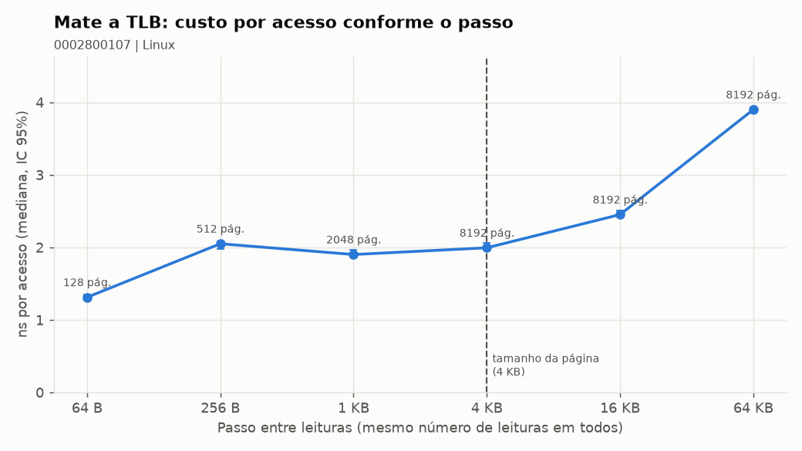

# Relatório: o penhasco da memória virtual

## 1. Identificação

- Dupla (id): 0002800107
- Integrantes: Larissa Giovanna e Gabriel Rios
- SO e versão: Linux Mint 22.3 (kernel 7.0.0-38-generic), x86_64
- CPU: AMD Ryzen 5 5600G with Radeon Graphics (12 núcleos lógicos)
- RAM total: 15,0 GB (15.351 MB)
- RAM disponível (available) no passo 1.1: 11,44 GB (11.711 MB)
- Tamanho da página: 4.096 bytes

## 2. Hipótese (escrita ANTES de rodar o 02)

- Alternativa escolhida (A, B, C ou D): **C**
- Bloco em que esperamos o salto: **12,2 GB (12.544 MB)**, o primeiro bloco acima dos
  11,44 GB disponíveis.
- Justificativa (1 frase, usando a tabela de latências do slide): ao passar da RAM disponível,
  cada página nova precisa expulsar outra para o swap; como o SSD NVMe tem latência de cerca de
  50.000 ns contra 10 ns da DDR4-3200 CL16 usada na calculadora (80 ns na tabela do slide; a
  especificação real do pente não é exposta no Linux sem `dmidecode`), o tempo por MB deve subir
  de 10x a 100x ou mais.

## 3. Medição: tabela do slide (saída do 02)

| Bloco | ms/MB (mediana) | major faults | swap ativo? |
|---|---|---|---|
| 256 MB | 0,606 | 0 | não |
| 512 MB | 0,554 | 0 | não |
| 1 GB | 0,554 | 0 | não |
| 2 GB | 0,534 | 0 | não |
| 4 GB | 0,527 | 0 | não |
| 8 GB | 0,548 | 0 | não |
| 12,2 GB | 0,681 | 0 | sim (~820 MB enviados ao swap) |

Em qual linha o ms/MB explodiu? **Em nenhuma.** O maior valor foi 0,681 ms/MB no bloco de
12,2 GB; a base dos blocos que couberam na RAM foi 0,551 ms/MB. O bloco passou apenas ~0,8 GB
da RAM disponível e o SO absorveu isso com page cache + swap, sem o salto de 10x previsto.
Salto em relação aos blocos pequenos: **1,2x** (0,681 / 0,551).

A hipótese se confirmou? (sim/não e por quê, 1 frase): **Não.** A alternativa C previa 10x–100x,
mas o 02 parou no primeiro bloco acima da disponível (12,2 GB); a desaceleração forte só começou
no 03, quando a memória disponível caiu abaixo de ~0,8 GB (até 4,5x a base).

## 4. Ponto de quebra (saída do 03) e gráfico

- Ponto de quebra (mediana das repetições): **não detectado (0 de 3 repetições)**. A varredura
  parou em 10.240 MB, o limite de segurança do script (RAM disponível + 50% do swap de 2 GB).
- Ponto de quebra observado: **9.216 MB na repetição 1** (0,92x os 9.990 MB disponíveis no início
  dela). Foi só o início da desaceleração: não atingiu o critério de 8x do script, então não há
  mediana entre as repetições.
- IC 95% do ponto de quebra: **não se aplica** (sem ponto de quebra detectado).
- Quebra / RAM disponível: **0,92** (9.216 / 9.990 MB, repetição 1).
- Bateu com a RAM disponível? Se não, por quê? **Não foi possível confirmar.** Só a repetição 1
  cruzou a disponível (foi até 10.240 MB) e desacelerou **antes** de zerar, porque o "available"
  inclui cache reclamável e o kernel começou a reclaimar/swap quando o livre real ficou baixo.
  As repetições 2 e 3 começaram com 10.806 e 10.722 MB disponíveis, acima do limite de
  10.240 MB, e por isso nunca chegaram a pressionar a RAM.

Na repetição 1 a base foi 0,561 ms/MB e as fatias finais ficaram em 1,753; 1,908; 2,554 e
2,359 ms/MB (3,1x a 4,5x a base), com swap out de 6,5 → 118,8 → 146,9 → 173,6 MB por fatia.
É o começo do penhasco: o SO tirou memória do page cache e do swap (o swap já vinha com ~836 MB
usados pelo 02).

## 5. TLB (saída do 04)

- Previsão antes de rodar: o custo sobe a partir do passo de **4.096 bytes** (uma página nova
  por acesso; 8.192 páginas distintas passam da capacidade da TLB).
- Resultado: o primeiro degrau aparece já em **256 bytes** (1,31 → 2,05 ns/acesso, 1,6x);
  depois há novo degrau em **16 KB** (2,45 ns) e **64 KB** (3,90 ns), que é **3,0x** o passo
  de 64 B.
- Explicação (1 a 2 frases): com 64 B as 8.192 leituras cabem em 128 páginas e a TLB resolve
  quase tudo; com 256 B já são 512 páginas, acima da L1 dTLB, e cada acesso paga a L2. A partir
  de 4 KB são 8.192 páginas distintas, acima da cobertura da TLB, e o page walk entra; em 16/64 KB
  o conjunto de dados (128/512 MB) também estoura o cache, somando a latência da DRAM.

## 6. Discussão (Think-Pair-Share)

- Resposta individual (CPU melhor ou mais RAM? Use o gráfico): **mais RAM.** O htop mostra a CPU
  a 30% (ociosa); o gargalo é a memória. No gráfico 03, quando o conjunto de trabalho chega perto
  da RAM disponível, o ms/MB sobe de ~0,55 para ~2,55 (4,5x) e o swap out cresce. Uma CPU melhor
  não elimina page faults nem swap, e a latência do disco (~50.000 ns) é milhares de vezes a da
  RAM (~10 ns).
- Uma diferença observada em relação à dupla de outro SO, e uma explicação: **não há medição de
  outra dupla/SO nos arquivos gerados.** A comparação disponível é com outra máquina Linux de
  7,6 GB (`resultados/gabriel`, modo `pagina`): lá o bloco de 4,2 GB, que passou dos 3,48 GB
  disponíveis, saltou para 5,65 ms/MB (15x a base), mostrando que o tamanho do salto depende de
  quanto o bloco ultrapassa a RAM. Na referência real de macOS com Apple Silicon (página de 16 KB), espera-se
  que a TLB "morra" no passo de 16 KB e que o penhasco apareça depois da RAM disponível, porque
  o macOS comprime a memória antes de usar o swap.

## 7. As 4 perguntas obrigatórias

1. **O que foi medido?**
   O tempo por MB para tocar blocos de 256 MB a 12,2 GB — até passar da RAM disponível —, os page
   faults (menores e maiores) e a atividade de swap. Complementamos com a varredura fina de
   256 MB (03) e com o custo por acesso para passos de 64 B a 64 KB (04).

2. **Como foi medido?** (ferramenta, métrica, repetições, o que confirma o swap)
   Scripts em Python com `psutil` e `mmap` anônimo. O 02 faz 1 aquecimento + 5 repetições por
   bloco que cabe na RAM (mediana e IC 95%; blocos acima de 80% da disponível rodam 1x) e grava
   `ms/MB`, faltas e deltas de swap. O 03 faz 3 varreduras de fatias de 256 MB. O 04 faz 8.192
   leituras por passo, 20 repetições, com mediana e IC 95%. O swap é confirmado pelos deltas de
   `swap_out`/`swap_usado` (no bloco de 12,2 GB: ~820 MB) e pela coluna "swap ativo?".

3. **Por que esse resultado?** (use os termos minor fault, major fault e swap)
   Cada página nova tocada gera um **minor fault** (aloca um frame); 12,2 GB = 3,2 milhões de
   minor faults. Quando a RAM disponível acaba, o kernel expulsa páginas anônimas para o
   **swap** (819,7 MB nesse bloco). Como o programa só escreve e não relê, não há **major fault**
   contabilizado nele; se relesse, cada página trazida do disco seria um major fault. O ms/MB só
   dispara quando a fração de páginas que vai ao disco domina o tempo — no 03 isso começou quando
   o disponível caiu abaixo de ~0,8 GB.

4. **Qual teoria explica?**
   A memória virtual com paginação por demanda: a TLB traduz endereços virtuais em físicos, a
   tabela de páginas e os page faults completam a tradução, e o swap é o "backing store" quando o
   conjunto de trabalho não cabe nos frames. O tempo efetivo é, aproximadamente,
   `T ≈ (1-p)·t_RAM + p·t_disco`; como `t_disco / t_RAM` é de 10³ a 10⁴, uma fração pequena `p`
   de faltas já domina. O "penhasco" é a transição do regime em que o working set cabe na RAM
   para o regime em que não cabe.
