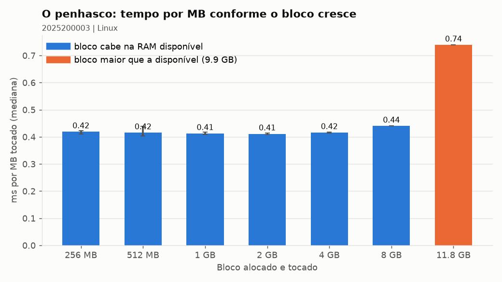
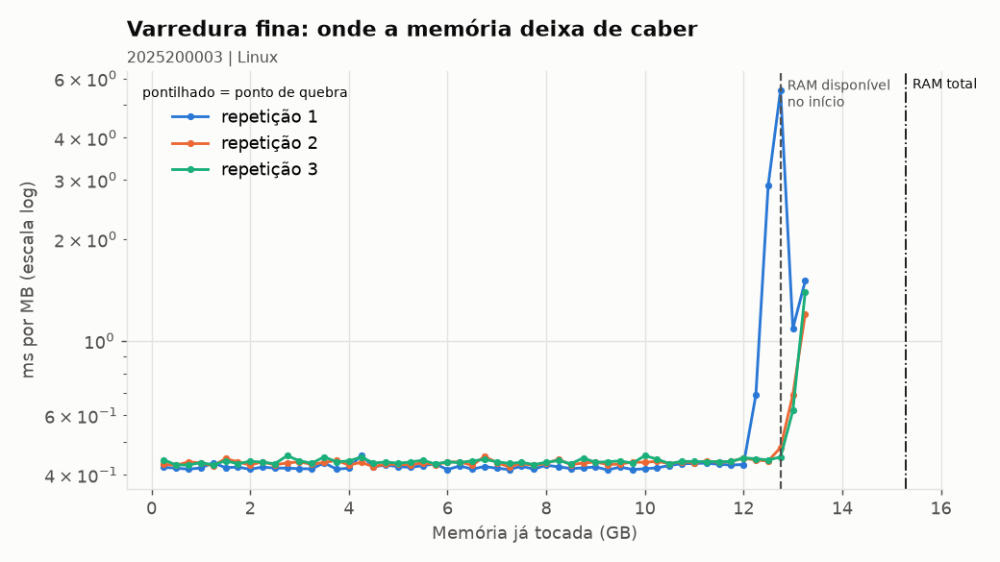
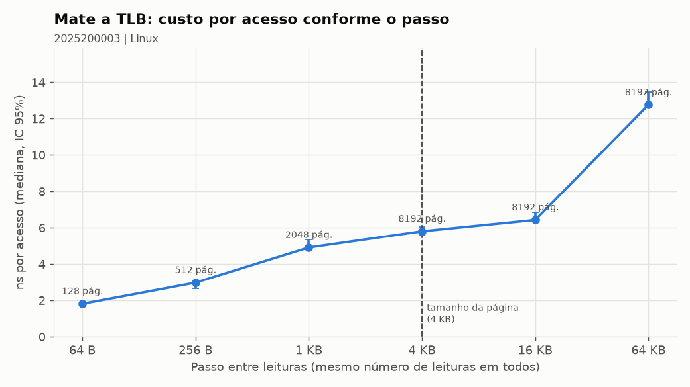

# Relatório: o penhasco da memória virtual

## 1. Identificação

- Identificador: 2025200003.
- Integrante: Brenno Dornelas de Medeiros Filho.
- Sistema: Ubuntu 24.04.5 LTS, kernel 6.14.0-37-generic, x86_64; Python 3.12.3.
- CPU: Intel Core i5-1035G1, 8 núcleos lógicos.
- RAM total: 15,28 GiB; disponível no passo 1.1: 9,73 GiB; swap total: 4 GiB.
- Página: 4.096 bytes. Os scripts chamam de MB/GB as unidades binárias MiB/GiB.

## 2. Hipótese registrada antes do experimento

Alternativa **C**, com salto esperado no **7º bloco**, ao ultrapassar a RAM disponível.
A justificativa é que acessar páginas no swap exige armazenamento, cuja latência no
exemplo do roteiro é muito maior: 50.000 ns no SSD NVMe contra 80 ns na RAM.
Essa comparação não determina, sozinha, a razão entre os tempos do programa inteiro.

## 3. Medição dos blocos (02)

| Bloco | ms/MB (mediana) | Major faults | Swap ativo? |
|---|---|---|---|
| 256 MB | 0,419 | 0 | Não |
| 512 MB | 0,415 | 0 | Não |
| 1 GB | 0,412 | 0 | Não |
| 2 GB | 0,411 | 0 | Não |
| 4 GB | 0,416 | 0 | Não |
| 8 GB | 0,440 | 0 | Sim |
| 12.032 MB (11,75 GiB) | 0,739 | 0 | Sim |

No último bloco, o custo subiu **1,78 vez** em relação à base de 0,415 ms/MB,
um acréscimo de aproximadamente 0,324 ms/MB. A hipótese de aumento de 10 a 100 vezes
**não se confirmou**. A RAM disponível no início do 02 era 10.109 MB, diferente da
leitura anterior, porque o estado do sistema muda ao longo da prática.

Os blocos de até 4 GB tiveram um aquecimento e cinco medições; os dois maiores,
uma medição cada. Por isso, não há IC 95% estimável para esses dois blocos.
No bloco de 12.032 MB, o contador global registrou aproximadamente **2.225,39 MB
enviados ao swap**. Isso confirma atividade de swap no sistema, mesmo com zero
major faults no processo medido.

## 4. Varredura fina (03): ponto de quebra e gráfico

| Repetição | RAM disponível no início (MB) | Ponto de quebra |
|---|---|---|
| 1 | 13.053 | Não detectado |
| 2 | 13.528 | Não detectado |
| 3 | 13.571 | Não detectado |

As três varreduras tocaram até **13.568 MB**, em fatias de 256 MB, e terminaram por
limite. O detector procurava três fatias consecutivas com custo de pelo menos
oito vezes a base; também aceitava uma sequência lenta ao fim da varredura.
Houve apenas um pico isolado de 5,545 ms/MB na primeira repetição, na fatia de
12.800 a 13.056 MB, seguido de valores menores. Portanto, **12.800 MB não é um
ponto de quebra confirmado**; mediana, IC 95% e razão quebra/disponível não se
aplicam. O roteiro prevê registrar a ausência de detecção como resultado.

Houve swap, mas sem degradação sustentada pelo critério usado. A faixa limitada
de memória testada e o fato de as páginas serem escritas pela primeira vez,
sem uma releitura completa das páginas expulsas, podem explicar esse resultado.
Os dados não permitem atribuir a ausência do penhasco apenas ao tamanho do swap.

## 5. Passo e TLB (04)

A previsão original apontava o maior aumento em **65.536 bytes**. As medianas
medidas foram:

| Passo (bytes) | Páginas distintas | ns/acesso |
|---|---|---|
| 64 | 128 | 1,81 |
| 256 | 512 | 2,98 |
| 1.024 | 2.048 | 4,91 |
| 4.096 | 8.192 | 5,80 |
| 16.384 | 8.192 | 6,43 |
| 65.536 | 8.192 | 12,76 |

O custo já aumentou no passo de 256 bytes; em 4.096 bytes foi 3,20 vezes o de
64 bytes, e em 65.536 bytes chegou a **7,04 vezes**. A previsão acertou o passo
mais caro, mas não há evidência de crescimento exponencial. O aumento é compatível
com menor localidade das traduções e mais falhas na TLB, que exigem consultar as
tabelas de páginas. Sem contadores de hardware, não se isola a contribuição da
TLB em relação aos caches. Esse teste não demonstra um gargalo de swap.

## 6. Discussão

Com CPU a 30% e swap ativo, eu priorizaria **mais RAM**: o gráfico 02 mostra aumento
do custo por MB junto à pressão de memória e à atividade de swap. Isso é compatível
com espera por memória/armazenamento; uma CPU mais rápida não resolve a falta de
capacidade de RAM. A medição, porém, não permite quantificar o ganho de uma compra.

Não há CSV de outra dupla nesta entrega para sustentar uma comparação de desempenho
entre Linux e Windows. Como referência identificada, a medição real de macOS/M1
fornecida em `dados/exemplo/` usa páginas de 16.384 bytes, contra 4.096 bytes aqui:
isso muda quantos acessos compartilham uma tradução. Os exemplos de Windows e Linux
do repositório são sintéticos e não foram tratados como medições da turma.

## 7. As quatro perguntas obrigatórias

1. **O que foi medido?** O tempo de escrita por MB em blocos e fatias de memória,
   a atividade de swap e os page faults; no teste de TLB, o tempo por acesso
   conforme a distância entre leituras.

2. **Como foi medido?** Com os scripts Python 01 a 04, usando os CSVs anexos.
   O 02 teve cinco medições por bloco pequeno e uma por bloco grande; o 03,
   três varreduras de 256 MB por fatia. O 04 teve 20 medições por passo, após
   três aquecimentos, com 500 voltas de 8.192 leituras. Foram usadas medianas;
   os ICs disponíveis nos resumos estimam a média com t de Student. Os deltas
   globais de swap-out confirmam a atividade de swap.

3. **Por que esse resultado?** O primeiro toque das páginas anônimas gera
   **minor faults**, resolvidos sem leitura do disco. **Major faults** exigem
   E/S para trazer páginas, mas ficaram em zero no processo medido. O **swap**
   global pode aumentar ao expulsar páginas de outros processos; como este
   experimento escreve páginas novas sem revisitar todo o conjunto, houve
   swap-out e lentidão sem um penhasco sustentado confirmado.

4. **Qual teoria explica?** Paginação por demanda, conjunto de trabalho e
   hierarquia de memória. Quando o conjunto ativo não cabe na RAM, a expulsão
   e a recuperação frequentes de páginas podem causar thrashing. Já a TLB
   guarda traduções de endereços virtuais para físicos; menor localidade e
   pressão sobre sua capacidade aumentam consultas às tabelas de páginas,
   mesmo quando os dados estão em cache.

Dados de apoio: [resumo das análises](../resultados/resumo_2025200003.md) e
CSVs 01 a 04 em `resultados/`, todos com o identificador 2025200003.
