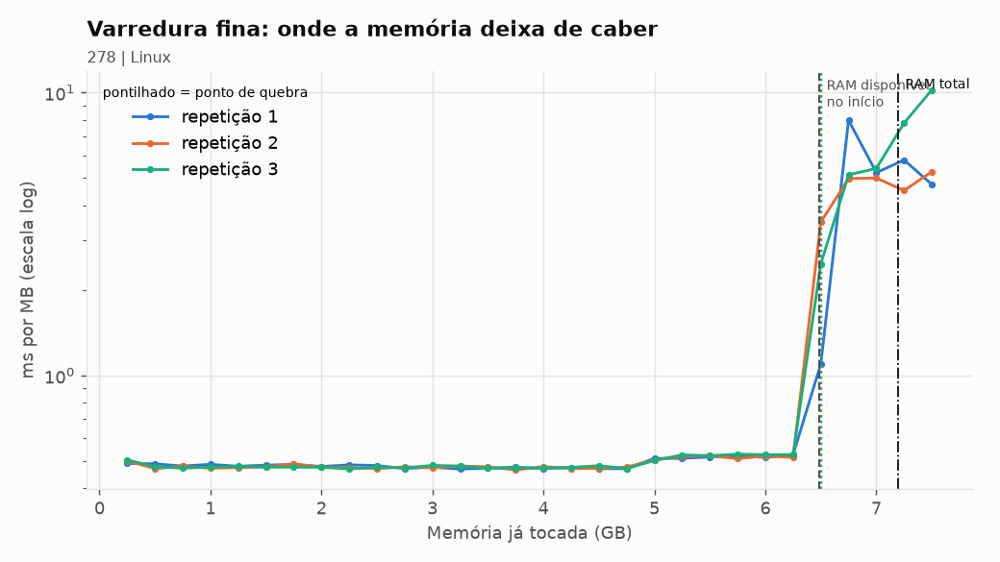
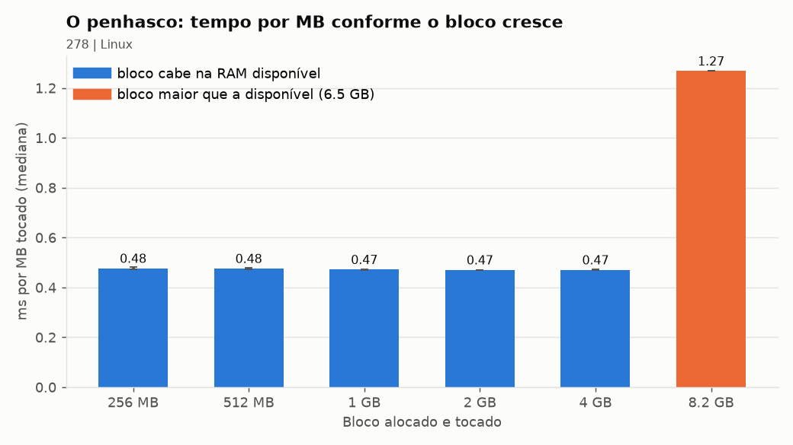
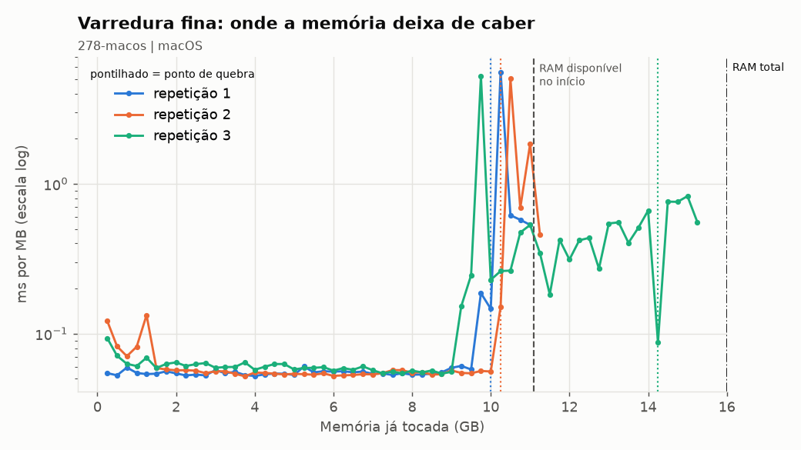
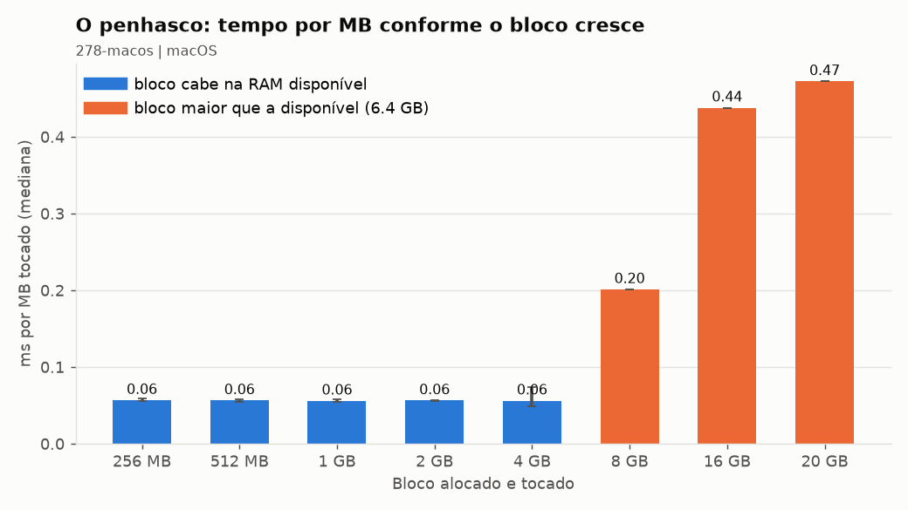
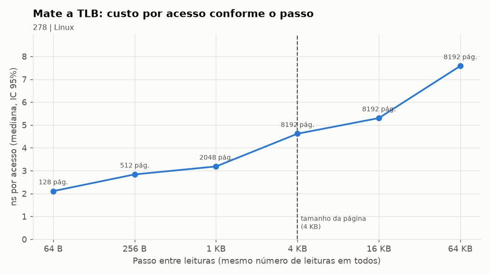
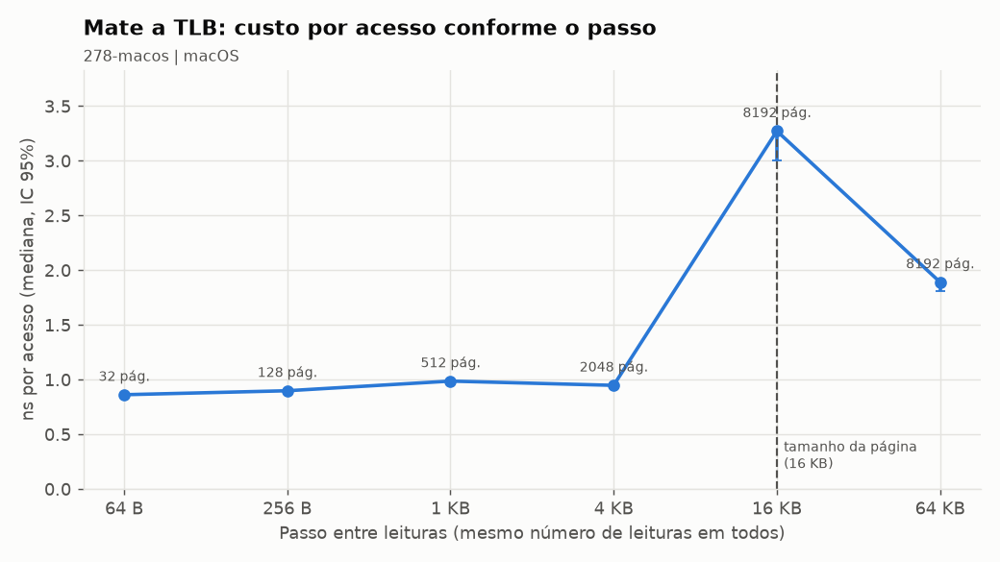
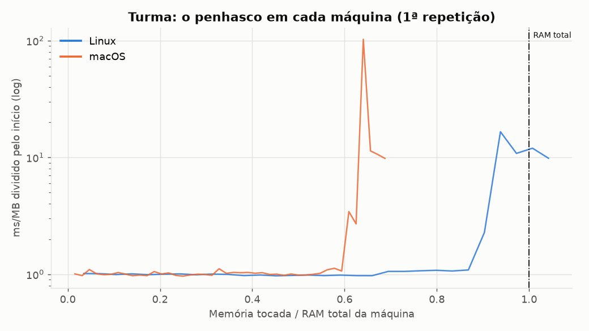
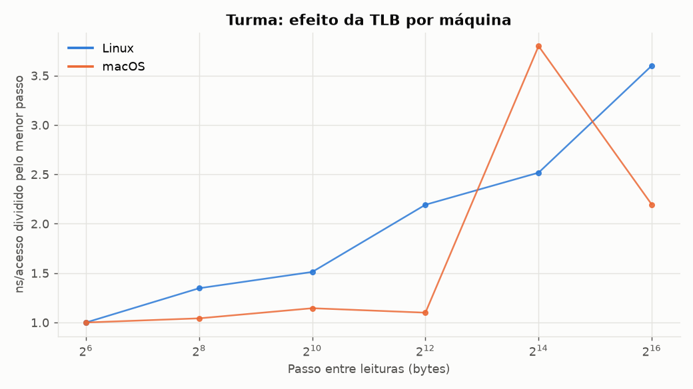

# Relatório: o penhasco da memória virtual

## 1. Identificação

- Dupla (id): 278
  - Caso precisa da completa: 2025200278
- Integrante: Carlos Murilo de Oliveira Costa Filho 
  - (individual; o macOS foi medido para a comparação, com autorização do professor).

| | Linux (id `278`) | macOS (id `278-macos`) |
|---|---|---|
| SO | Ubuntu Server 26.04.1 LTS, kernel 7.0.0-42 | macOS 27.2 |
| CPU | Intel i5-8400, 2,8 GHz | Apple M4 |
| RAM total | 7,2 GB (DDR4-2400, CL17 assumida, CAS ≈ 14,17 ns) | 16 GB (LPDDR5) |
| RAM disponível (passo 1.1) | 6,54 GB | 6,31 GB |
| Página | 4096 B | 16384 B |
| Disco / swap | SSD SATA, arquivo de 4 GB, sem zram | SSD interno, swap cresce sob demanda |

## 2. Hipótese (escrita antes de rodar o 02)

- Alternativa: **C**. Salto esperado no primeiro bloco acima de ~6,5 GB (RAM disponível).
- Justificativa: passando da RAM, cada página vai ao swap em disco (~50 000 ns) em vez da RAM (~80 ns), cerca de 600x mais lento; com agrupamento de I/O deve ficar menor, mas ainda ≥ 10x.

## 3. Medição (saída do 02, ms/MB, mediana)

| Bloco | Linux | macOS |
|---|---|---|
| 256 MB | 0,477 | 0,057 |
| 512 MB | 0,476 | 0,056 |
| 1 GB | 0,472 | 0,056 |
| 2 GB | 0,470 | 0,056 |
| 4 GB | 0,471 | 0,056 |
| 8 GB | **1,268** (8448 MB; 73 major faults; swap ativo) | **0,201** (swap ativo) |
| 16 GB | n/d | **0,438** (swap ativo) |
| 20 GB | n/d | 0,472 (swap ativo) |

- Explodiu no primeiro bloco maior que a RAM disponível: Linux 8448 MB (~2,7x a base de 0,472); macOS 8 GB (3,6x), 16 GB (7,8x) e 20 GB (8,4x a base de 0,056). Major faults no macOS: 0.
- Hipótese: **em parte**. O bloco do salto foi o previsto, mas a média foi ~2,7x, abaixo de 10x. O bloco de 8448 MB inclui ~6,7 GB que ainda couberam na RAM; só os ~1,8 GB excedentes pagaram o swap, a ~4,3 ms/MB (≈9x; estimativa: 8448 × 1,268 ms ≈ 10,7 s menos ~3,2 s dos primeiros 6682 MB).

## 4. Ponto de quebra (saída do 03) e gráficos

| | Linux | macOS |
|---|---|---|
| Quebra (mediana de 3 repetições) | **6656 MB** (6656, 6656, 6656) | **10496 MB** (10240, 10496, 14592) |
| IC 95% | [6656, 6656] MB (as 3 deram o mesmo ponto) | [5709, 17843] MB |
| Quebra / RAM disponível | 0,98 (1,00, 0,98, 0,98) | 0,92 (0,90, 0,90, 1,28) |
| Salto (fatia mais lenta / início) | 11x, 11x, 14x (5,0 a 6,6 ms/MB) | 11x, 15x, 11x (0,6 a 1,3 ms/MB) |

- **Bateu com a RAM disponível?** Sim. No Linux o custo saiu de ~0,5 ms/MB exatamente na fatia de 6656 MB, onde a disponível chegou a ~140 MB (a RAM disponível no início era ~6,7 GB). No macOS a quebra veio em ~0,9x a disponível medida no 03 (~11,4 a 11,7 GB; no 02 eram 6,6 GB, e o bloco de 8 GB custou só 3,6x). No macOS a subida é menos abrupta que no Linux: a repetição 3 começa a subir de forma gradual (0,06 para ~0,2 a 0,8 ms/MB) a partir de ~9 GB, com uma fatia isolada de ~5 ms/MB em ~10 GB, e o critério do script só confirmou a quebra em 14592 MB, o que alarga o IC.
- **Zona intermediária (Linux):** a partir de ~5 GB (disponível < 1,7 GB) o custo subiu ~10% (0,47 para 0,52 ms/MB): o kernel descarta cache de arquivos antes de usar o swap. O salto real começa com a disponível em ~140 MB.
- **Monitor:** Linux, `so` de 180 a 310 MB/s e swap de ~65 MB até 1932 MB (no 02) e ~1,1 GB (no 03); `si` ≈ 0. macOS, swap de ~20 MB até ~12,3 GB e `so` de até ~1320 MB/s.

Linux:

macOS:

## 5. TLB (saída do 04, ns/acesso)

| Passo | 64 B | 256 B | 1 KB | 4 KB | 16 KB | 64 KB | Pior / menor |
|---|---|---|---|---|---|---|---|
| Linux (página 4 KB) | 2,11 | 2,84 | 3,18 | 4,62 | 5,30 | 7,58 | 3,6x |
| macOS (página 16 KB) | 0,86 | 0,90 | 0,99 | 0,95 | **3,27** | 1,89 | 3,8x |

- **Previsão:** o custo sobe a partir do passo de 4096 B (tamanho da página). No Linux acertou em parte: o custo já subia 1,3x em 256 B e continuou crescendo até 64 KB.
- **Resultado:** no Linux o aumento é gradual; no macOS o custo salta no passo de 16 KB, o tamanho da página dele.
- **Explicação:** as 8192 leituras somam só 512 KB, mas com passos maiores visitam mais páginas distintas (até 8192); quando passam da capacidade da TLB, cada acesso paga uma caminhada na tabela de páginas. O efeito também mistura cache, pois a extensão varrida cresce de 0,5 a 512 MB.

## 6. Discussão

- **Resposta individual (CPU ou RAM?):** mais RAM. No gráfico 03 o custo é ~0,5 ms/MB enquanto cabe na RAM e salta 11x a 14x ao passar da disponível; ali o programa espera o disco (`so` de 180 a 310 MB/s), então a CPU fica ociosa (como no "CPU a 30% e swap ativo"). Uma CPU mais rápida não acelera essa espera; mais RAM empurra o penhasco para frente.
- **Diferença entre SOs (Linux contra macOS, meu servidor e meu Mac):**
  - O salto relativo é parecido (~11x a 15x), mas o absoluto é bem menor no macOS (0,6 a 1,3 contra 5,0 a 6,6 ms/MB). Compatível com SSD interno mais rápido (o do servidor é SATA) e com o macOS comprimindo memória antes de usar o swap, que cresceu até ~12,3 GB (no Linux o limite fixo é 4 GB). Os 0 major faults no macOS sugerem resolução por descompressão, não por leitura de disco. É hipótese minha, não medi a compressão.
  - A base é ~8x menor no macOS (0,056 contra 0,472 ms/MB): plausível por LPDDR5 de chip mais novo e páginas 4x maiores (menos faltas por MB); não isolei qual fator pesa mais.
  - A TLB "morre" no tamanho da página de cada máquina: 16 KB no macOS, ~4 KB (gradual) no Linux. No macOS o passo de 64 KB ficou mais barato que o de 16 KB; não investiguei o motivo.

## 7. As 4 perguntas obrigatórias

1. **O que foi medido?** O tempo por MB para escrever em memória alocada, em blocos de 256 MB a 8448 MB no Linux e a 20 GB no macOS (02) e em fatias de 256 MB (03), com RAM disponível, major faults e swap. Resultado: ~0,47 ms/MB (Linux) enquanto cabe na RAM; ao passar da disponível, 5 a 10 ms/MB nas fatias mais lentas (11x a 14x), quebra mediana em 6656 MB (0,98x a disponível).
2. **Como foi medido?** Scripts Python (`02_tocar_blocos.py`, `03_penhasco_fino.py`, `04_passo_tlb.py`). Blocos que cabem na RAM: 1 aquecimento + 5 repetições, com mediana e IC 95%; blocos acima de 80% da disponível, 1 execução. O 03 faz 3 varreduras em fatias de 256 MB. O swap é confirmado pelo `monitor_memoria.py` (`so`, `si`, swap usado) e pelos major faults.
3. **Por que esse resultado?** Enquanto cabe na RAM, cada página nova gera só um *minor fault* (página zerada, sem I/O): custo baixo e constante, 0 major faults. Ao esgotar a RAM (piso de ~140 MB), o kernel descarta cache e envia páginas ao **swap** em disco (~50 000 ns contra ~80 ns da RAM): daí o salto de 11x a 14x. Um *major fault* é a leitura de volta de uma página do swap (73 no bloco de 8448 MB); foram poucos porque o teste só escreve em páginas novas (`si` ≈ 0).
4. **Qual teoria explica?** Memória virtual com paginação por demanda: o SO mantém as páginas menos usadas no swap e as traz de volta por page fault. Quando o conjunto de trabalho passa da RAM física, cada acesso passa a custar uma ida ao disco, o que gera o penhasco (no limite, thrashing). A TLB é o cache da tabela de páginas: com mais páginas do que ela comporta, cada acesso paga também a caminhada na tabela.
