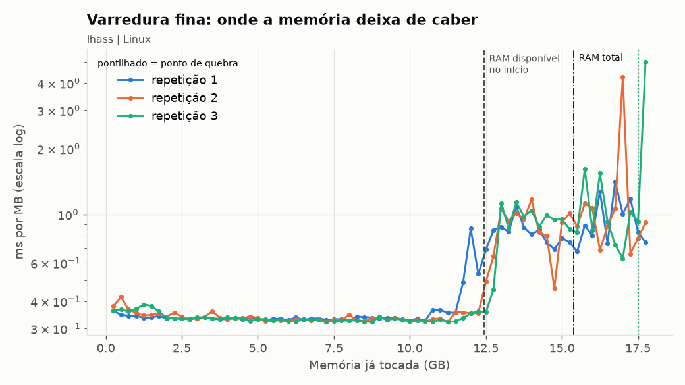
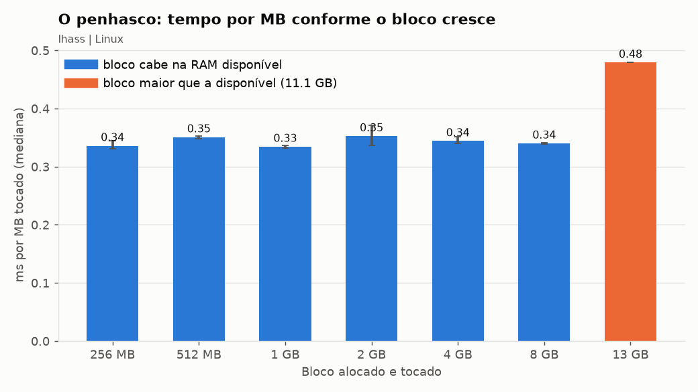

# Relatório: o penhasco da memória virtual

## 1. Identificação

- Dupla (id): lhass
- Integrantes: Luis Henrique Alves Sampaio Santos (lhass)
- SO e versão: Ubuntu 26.04.1 LTS, kernel 7.0.0-42-generic (x86_64)
- CPU: Intel Core i5-11400H de 11ª geração, 2,70 GHz, 12 núcleos lógicos
- RAM total: 15,4 GB
- RAM disponível (available) no passo 1.1: 11,2 GB
- Tamanho da página: 4096 bytes
- Swap: 4 GB em arquivo no disco (/swap.img), sem uso no início

No passo 1.1 a RAM "free" estava entre 0,3 e 1 GB, mas a "available" estava em 11,2 GB. Essa diferença é page cache, que o kernel consegue descartar sem ir ao disco, por isso usei a available como referência.

Na calculadora DDR vi que a DDR4-3200 CL16 e a DDR4-3600 CL18 têm a mesma latência CAS, 10 ns. A 3600 ganha só em vazão (28,8 contra 25,6 GB/s por canal).

## 2. Hipótese (escrita ANTES de rodar o 02)

- Alternativa escolhida: C
- Bloco em que espero o salto: 16 GB, pois é o primeiro bloco acima dos 11,2 GB disponíveis (o de 8 GB ainda cabe na RAM)
- Justificativa: o SSD NVMe é cerca de 625 vezes mais lento que a RAM (50 000 ns contra 80 ns), então quando o bloco passar da RAM disponível os major faults devem multiplicar o tempo por MB. Espero um aumento de dezenas de vezes e não de 625, pois cada falta move uma página inteira de 4 KB e como o acesso é sequencial o kernel consegue agrupar as escritas no swap.

## 3. Medição: tabela do slide (saída do 02)

| Bloco | ms/MB (mediana) | IC 95% | major faults | swap ativo? |
|---|---|---|---|---|
| 256 MB | 0,336 | 0,331 a 0,345 | 0 | não |
| 512 MB | 0,351 | 0,348 a 0,353 | 0 | não |
| 1 GB | 0,334 | 0,332 a 0,336 | 0 | não |
| 2 GB | 0,353 | 0,336 a 0,371 | 0 | não |
| 4 GB | 0,344 | 0,340 a 0,352 | 0 | não |
| 8 GB | 0,340 | 0,338 a 0,341 | 0 | sim |
| 13 GB (13 312 MB) | 0,479 | 1 execução | 2 | sim |

Obs.: o script reduziu o limite de 19 706 MB para 13 369 MB por causa do tamanho do swap (4 GB). Por isso o maior bloco foi de 13 312 MB e não de 16 GB. A RAM disponível no início do 02 era 11 322 MB.

Em qual linha o ms/MB explodiu? Não chegou a explodir, o maior aumento foi no bloco de 13 312 MB.
Salto em relação aos blocos pequenos: cerca de 1,4x (0,479 / 0,343)

Deixei o monitor_memoria.py rodando em outro terminal (1 leitura por segundo). Durante o bloco de 13 312 MB ele mostrou:

| Hora | RAM disponível | Swap usado | si (MB/s) | so (MB/s) |
|---|---|---|---|---|
| 09:03:24 | 4 316 MB | 36 MB | 0,0 | 0,0 |
| 09:03:25 | 2 129 MB | 264 MB | 0,1 | 227 |
| 09:03:26 | 1 016 MB | 570 MB | 0,3 | 291 |
| 09:03:27 | 616 MB | 1 285 MB | 0,5 | 584 |
| 09:03:28 | 393 MB | 2 454 MB | 1,2 | 936 |
| 09:03:29 (fim) | 13 319 MB | 2 006 MB | 23,2 | 91 |

O que percebi:
- O swap out chegou perto de 0,9 GB/s, enquanto o swap in ficou quase em zero. Ou seja, o kernel escreveu cerca de 2,4 GB no swap mas quase nada foi lido de volta durante o teste.
- No bloco de 8 GB já teve um swap out pequeno (22 a 36 MB), por isso essa linha aparece com swap ativo.
- Depois do teste apareceram picos de si (até 76 MB/s). Eram os outros programas abertos trazendo de volta as páginas deles, então quem pagou o custo do swap foram eles e não o meu processo.
- No final a RAM disponível ficou em 13,1 GB, mais que os 11,3 GB do começo, porque parte das páginas dos outros programas continuou no swap.

A hipótese se confirmou? Não nesse bloco. O salto foi de 1,4x e não de 10 a 100x. O bloco de 13 312 MB passou só uns 2 GB da RAM disponível e o kernel cobriu isso descartando page cache e mandando páginas de outros programas para o swap. Como o meu programa só escreve cada página uma vez e nunca lê de volta, ele quase não teve major faults (só 2).

## 4. Ponto de quebra (saída do 03) e gráfico

Mudança de método: com 4 GB de swap o script não conseguia passar muito da RAM, então antes de rodar o 03 criei um swap temporário de 8 GB (/swapfile_lab), ficando com 12 GB no total. Com isso o limite subiu para 18 196 MB. Depois dos testes o swap temporário foi removido.

A linha de base ficou em torno de 0,33 ms/MB. Como critério de quebra usei a primeira fatia com pelo menos o dobro da linha de base e que continua alta nas fatias seguintes.

| Repetição | Disponível no início | Quebra (2x a base) | Quebra / disponível | Depois da quebra | Detecção do script (8x) |
|---|---|---|---|---|---|
| 1 | 12 749 MB | 12 288 MB (0,861 ms/MB) | 0,96 | 0,7 a 1,4 ms/MB | não detectou |
| 2 | 13 164 MB | 13 312 MB (1,062 ms/MB) | 1,01 | 0,8 a 1,2 ms/MB, pico de 4,25 | não detectou |
| 3 | 13 414 MB | 13 312 MB (1,128 ms/MB) | 0,99 | 0,85 a 1,6 ms/MB, pico de 5,01 | 17 920 MB (1,34x) |

- Ponto de quebra (mediana das repetições): 13 312 MB
- Faixa observada: 12 288 a 13 312 MB (com só 3 repetições o IC 95% não é confiável)
- Quebra / RAM disponível: 0,99 (mediana de 0,96, 1,01 e 0,99)
- Bateu com a RAM disponível? Sim. Nas três repetições a quebra aconteceu quando a RAM disponível chegou no piso de 300 a 400 MB, que é uma reserva que o kernel mantém e não entrega para o processo. O ponto de quebra acompanhou a disponível de cada repetição, que foi subindo (12,7, 13,2 e 13,4 GB) porque cada varredura empurrava mais páginas dos outros programas para o swap.

Sobre a detecção automática: tanto o 03 quanto o analise.py dizem "quebra em 17 920 MB, razão 1,34", pois eles só marcam fatias 8x mais lentas que a base. Como depois da quebra o tempo ficou em torno de 3x, só uns picos isolados passaram de 8x. Por isso as repetições 1 e 2 deram "não detectado" e a 3 marcou 17 920 MB, que na verdade é um pico no fim da varredura e não o começo do penhasco.

Por que o salto foi de 3x e não de 100x? O monitor mostrou swap out entre 1 e 1,27 GB/s durante as varreduras, com swap in baixo (no máximo 31 MB/s). Depois da quebra, para cada MB novo o kernel precisa jogar 1 MB no swap, então o custo esperado é 1 MB / 1,1 GB/s, o que dá uns 0,9 ms/MB. Isso bate com o que medi (0,85 a 1,1 ms/MB). Como o programa escreve e não lê de volta, ele paga a vazão de escrita do NVMe e não a latência de um major fault por página.

Gráfico: as três curvas sobem logo depois da linha "RAM disponível no início". A linha pontilhada verde perto de 17,5 é a quebra automática do script, explicada acima. O eixo do gráfico está em GiB (MB / 1024).

## 5. TLB (saída do 04)

- Previsão antes de rodar: o custo sobe a partir do passo de 4096 bytes. Com passo de 4 KB as 8192 leituras percorrem 32 MB e cada leitura cai numa página diferente (8192 páginas), mais do que as cerca de 2048 entradas da TLB de segundo nível. Nos passos de 16 KB e 64 KB o número de páginas é o mesmo. Obs.: minha primeira ideia foi 64 KB, mas mudei depois de fazer a conta das páginas.

| Passo | Páginas distintas | Extensão | ns/acesso (mediana) | IC 95% | Vezes o passo de 64 B |
|---|---|---|---|---|---|
| 64 B | 128 | 0,5 MB | 0,98 | 0,98 a 0,98 | 1,0 |
| 256 B | 512 | 2 MB | 2,03 | 2,03 a 2,04 | 2,1 |
| 1 KB | 2 048 | 8 MB | 3,13 | 3,12 a 3,14 | 3,2 |
| 4 KB | 8 192 | 32 MB | 3,82 | 3,82 a 3,85 | 3,9 |
| 16 KB | 8 192 | 128 MB | 4,31 | 4,30 a 4,37 | 4,4 |
| 64 KB | 8 192 | 512 MB | 5,50 | 5,49 a 5,53 | 5,6 |

- Resultado: o custo sobe a cada passo, sem um degrau único em 4 KB. O maior salto foi de 64 B para 256 B (2,1x). Em 4 KB o custo é 3,9x o de 64 B e em 64 KB chega a 5,6x. A previsão de 4 KB se confirmou só em parte.
- Explicação: os dados lidos são sempre os mesmos 512 KB, o que muda é quantas páginas são visitadas. A TLB tem dois níveis: o primeiro tem cerca de 64 entradas e já não dá conta a partir de 256 B, e o segundo tem cerca de 2048 e deixa de dar conta entre 1 KB e 4 KB, quando cada acesso passa a precisar de um page walk. Em 16 KB e 64 KB as páginas são as mesmas 8192, mas ficam mais espalhadas, então as entradas da tabela de páginas também ficam espalhadas e cada page walk sai mais caro. Os valores são de poucos ns pois as leituras são independentes e a CPU faz várias ao mesmo tempo, então o script mede vazão e não a latência de um acesso sozinho. Nesse teste nenhuma página foi para o swap, o custo é só da tradução de endereços feita pelo hardware.

## 6. Discussão (Think-Pair-Share)

- Resposta individual (CPU melhor ou mais RAM?): Mais RAM. Com swap ativo e a CPU em 30%, a CPU passa boa parte do tempo esperando a memória e não processando. No meu gráfico 03 o tempo fica estável em 0,33 ms/MB enquanto tudo cabe na RAM disponível e sobe para cerca de 1 ms/MB (3x, com picos de 15x) quando passa dela. Esse custo depende da velocidade do disco, então trocar a CPU não resolve. Com mais RAM o penhasco vai mais para a direita e o serviço passa a caber na memória.
- Uma diferença observada em relação à dupla de outro SO, e uma explicação: [preencher depois da discussão]

## 7. As 4 perguntas obrigatórias

1. **O que foi medido?**
   Medi o tempo para alocar e escrever na memória (ms por MB) conforme o tamanho usado aumenta, de 256 MB até uns 18 GB, para achar o ponto em que o uso passa da RAM disponível e o desempenho cai, o penhasco do swap. Também medi o custo de cada leitura (ns por acesso) com 8192 leituras em passos de 64 B a 64 KB, para ver o efeito do número de páginas visitadas na TLB.

2. **Como foi medido?**
   Usei os scripts em Python do repositório da prática (psutil e numpy) num notebook com Ubuntu 26.04, i5-11400H, 15,4 GB de RAM, página de 4 KB e SSD NVMe. O 02 testou blocos de 256 MB a 13 GB, com aquecimento e 5 repetições nos blocos que cabem na RAM e 1 execução nos maiores, usando mediana e IC 95%. O 03 percorreu uma região de 18 GB em fatias de 256 MB, 3 vezes, depois de aumentar o swap de 4 para 12 GB. O 04 fez 8192 leituras, 500 voltas e 20 repetições por passo. Confirmei o swap pelo monitor_memoria.py: na hora da quebra a RAM disponível caiu para 300 a 400 MB, o swap usado chegou a uns 7 GB e o swap out ficou entre 1 e 1,27 GB/s.

3. **Por que esse resultado?**
   Enquanto ainda tem RAM disponível, cada página nova custa só um minor fault, pois o SO entrega uma página zerada sem precisar do disco, e o tempo fica estável em 0,33 ms/MB. Quando a RAM acaba, para cada página nova o kernel precisa mandar outra para o swap (swap out) e o tempo sobe para cerca de 1 ms/MB, que é o que se espera escrevendo no NVMe a 1,1 GB/s. No bloco de 13 312 MB do 02 o CSV mostra 3 407 879 minor faults, quase exatamente 13 312 MB / 4 KB = 3 407 872, ou seja, uma por página. Já os major faults foram só 2, com 2 050 MB de swap out e só 2 MB de swap in. Isso acontece porque major fault só ocorre quando uma página precisa voltar do swap, e o meu programa escreve cada página uma vez e não lê de volta. Por isso o salto foi de uns 3x (com picos de 15x) e não de 625x, que seria a diferença de latência entre disco e RAM. Quem pagou o swap in foram os outros programas, depois do teste.

4. **Qual teoria explica?**
   Memória virtual com paginação sob demanda. Cada processo vê um espaço de endereços virtual dividido em páginas de 4 KB, e o SO mapeia essas páginas para quadros na RAM ou para o swap no disco. A RAM funciona como um cache das páginas: enquanto o conjunto de trabalho cabe nela o custo é o da RAM, e quando não cabe o SO escolhe páginas para mandar ao swap e o custo passa a ser o do disco, como na hierarquia de memória. A tradução do endereço virtual para o físico é feita pela MMU usando a tabela de páginas, e a TLB guarda as traduções mais usadas. Quando o número de páginas passa do que a TLB consegue guardar, cada acesso precisa de um page walk, e isso explica o custo subir de 0,98 para 5,5 ns por acesso no 04 mesmo com os dados cabendo no cache.
